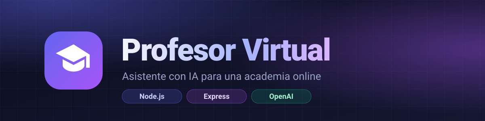
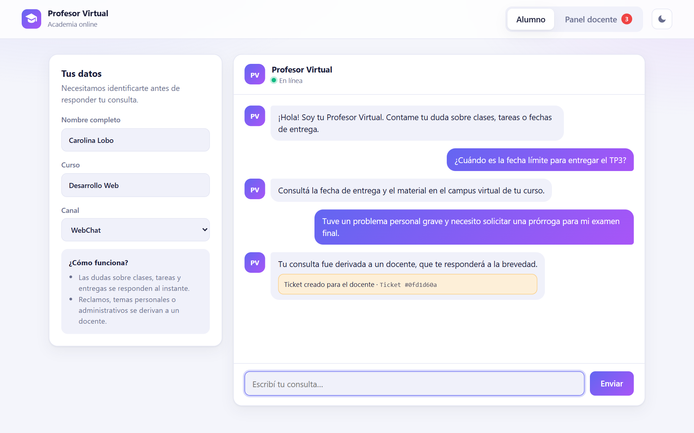
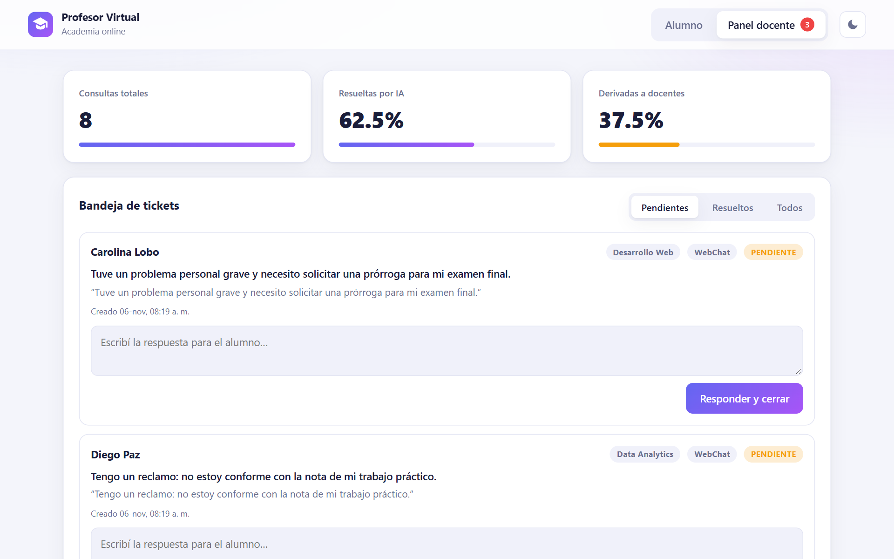
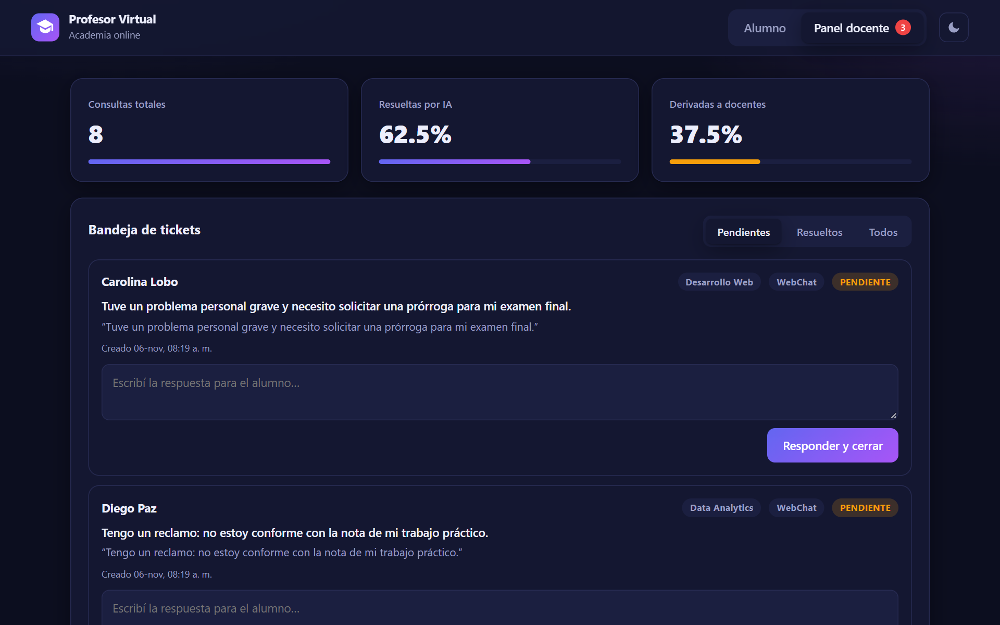
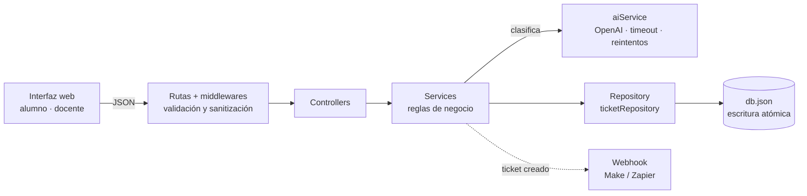

<div align="center">



**Asistente virtual que responde las dudas frecuentes de los alumnos y deriva a un docente, con un ticket, todo lo que requiere una persona**


[Cómo levantarlo](#cómo-levantarlo) · [Qué hace](#qué-hace) · [API](#api) · [Arquitectura](#arquitectura) · [Trabajos prácticos](#trabajos-prácticos)

</div>

**Proyecto de Carolina Lobo** · Generación T · Módulo 3 · Argentina · 2026

---

## Capturas

| Chat del alumno | Panel docente |
|---|---|
|  |  |

<details>
<summary>Modo oscuro</summary>



</details>

---

## Qué hace

| Para el alumno | Para el docente |
|---|---|
| **Chat** web (o WhatsApp) con respuesta inmediata a dudas sobre clases, tareas y fechas | **Bandeja de tickets** con las consultas derivadas, filtrable por estado |
| **Identificación** por nombre y curso antes de procesar la consulta | **Respuesta formal** que cierra el ticket; no se puede cerrar sin ella |
| Aviso claro cuando su consulta fue **derivada** a una persona | **Métricas**: % resuelto por IA vs. derivado a docentes |
| Sugerencias rápidas y diseño adaptable a celular, con modo claro/oscuro | **Notificación** opcional por webhook (Make/Zapier) al crear un ticket |

### Reglas de negocio

- Todo **reclamo, disconformidad o duda personal** se marca como no frecuente y genera un ticket, aunque la IA lo haya tomado como frecuente.
- Un ticket derivado **no se cierra** sin una respuesta explícita de un docente.
- Se valida la **identidad** del alumno (nombre y curso) antes de invocar a la IA.
- Si OpenAI no responde (timeout y reintentos con espera creciente), la consulta se **deriva a un docente** en lugar de fallar.

---

## Cómo levantarlo

Necesitás **Node 20 o superior**.

```bash
npm install
cp .env.example .env     # opcional: completar OPENAI_API_KEY
npm start
```

Después entrá a **<http://localhost:3000>**. Sin `OPENAI_API_KEY` funciona con un clasificador local de respaldo, ideal para probar.

Para ver el panel docente con datos de ejemplo, con el servidor andando:

```bash
npm run seed
```

| Comando | Qué hace |
|---|---|
| `npm start` | Servidor en `:3000` (API + interfaz web) |
| `npm run dev` | Igual, con recarga automática |
| `npm run seed` | Carga consultas de ejemplo |
| `npm test` | Pruebas de la API (5) |

### Variables de entorno

| Variable | Descripción | Por defecto |
|---|---|---|
| `PORT` | Puerto del servidor | `3000` |
| `OPENAI_API_KEY` | Clave de OpenAI (vacía = clasificador local) | — |
| `OPENAI_MODEL` | Modelo a usar | `gpt-4o-mini` |
| `OPENAI_TIMEOUT_MS` / `OPENAI_MAX_RETRIES` | Timeout y reintentos ante caídas | `10000` / `2` |
| `TICKET_WEBHOOK_URL` | Webhook al crearse un ticket | — |
| `DATA_FILE` | Archivo de persistencia | `data/db.json` |

---

## API

| Método | Endpoint | Descripción |
|---|---|---|
| `POST` | `/api/v1/chat/message` | `{ studentName, course, message, channel }` → respuesta o ticket |
| `GET` | `/api/v1/tickets?status=PENDING` | Lista tickets (`PENDING` o `RESOLVED`) |
| `PATCH` | `/api/v1/tickets/:id/resolve` | `{ teacherReply }` responde y cierra el ticket |
| `GET` | `/api/v1/analytics/summary` | Métricas de automatización |

```bash
curl -X POST http://localhost:3000/api/v1/chat/message \
  -H "Content-Type: application/json" \
  -d '{"studentName":"Carolina Lobo","course":"Desarrollo Web","message":"¿Cuándo es la entrega del TP3?","channel":"WebChat"}'
```

---

## Arquitectura

Capas **Controller → Service → Repository**: cada una tiene una única responsabilidad y la persistencia se puede reemplazar sin tocar las reglas de negocio.



```
src/
  controllers/   HTTP y respuestas JSON
  services/      reglas de negocio, IA y webhooks
  repositories/  persistencia (archivo JSON, reemplazable)
  middlewares/   validación/sanitización y manejo de errores
  routes/
public/          interfaz web (HTML, CSS y JS sin dependencias)
agents/          subagente revisor de código (solo lectura)
docs/            entregas de los trabajos prácticos
tests/           pruebas con node:test
```

---

## Trabajos prácticos

| Entrega | Documento |
|---|---|
| TP 4 — Diseñando el backend | [docs/tp4-backend-profesor-virtual.md](docs/tp4-backend-profesor-virtual.md) |
| TP 5 — Analizar antes de pedir | [docs/tp5-analizar-antes-de-pedir.md](docs/tp5-analizar-antes-de-pedir.md) |
| Clase 17 — Mejorá el agente | [docs/tp6-mejora-del-agente-revisor.md](docs/tp6-mejora-del-agente-revisor.md) · [agents/revisor.md](agents/revisor.md) |
| Clase 19 — Medí tu revisor | [docs/tp7-medi-tu-revisor.md](docs/tp7-medi-tu-revisor.md) |

---

## Autoría

Proyecto de **Carolina Lobo**, desarrollado durante el Módulo 3 de Generación T. Licencia MIT.
